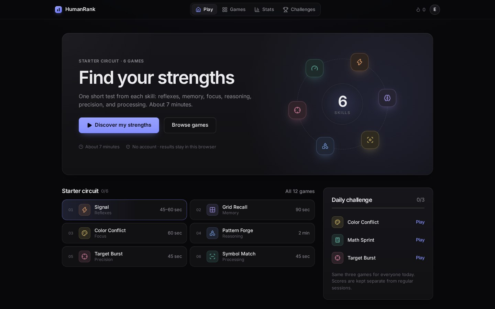
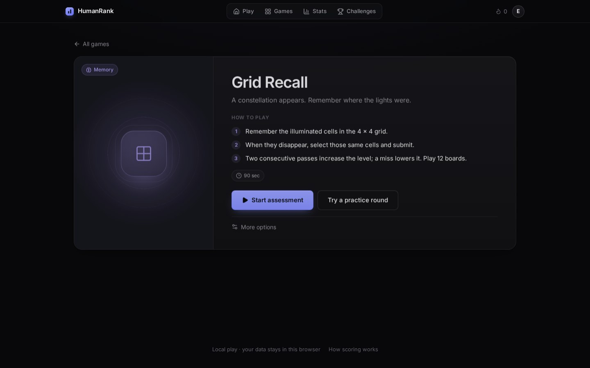

# HumanRank

A human performance arcade with twelve games covering reflexes, memory, focus, reasoning, precision, and processing speed. Try a practice round, take a full assessment, or play a daily challenge and track your results over time.

[Play HumanRank](https://human-benchmark.ericzwierzynski.dev)





## How it works

Games run in the browser, and IndexedDB stores your history. Practice runs are shorter and do not count toward your records. The optional Supabase backend adds accounts and population comparisons when enough results are available.

## Run locally

Use Node.js 24 or later and npm.

```sh
npm ci
npm run dev
```

Open the address printed by the launcher. It starts at [127.0.0.1:5174](http://127.0.0.1:5174) and uses the next available port if needed. Local play requires no credentials. Use `npm run check` to run the project checks and build.

[Optional backend setup](docs/backend-setup.md) · [Measurement research](docs/measurement-research.md) · [Deployment](docs/DEPLOYMENT.md)
