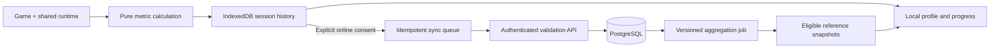

# HumanRank — product and implementation plan

Status: approved by the owner on October 21, 2026 (America/New_York). Implementation authorized; initialize Git first, then execute the three phases.

## 1. Direction and decisions

HumanRank is a premium arcade for discovering and improving your performance across six kinds of challenge. The promise is **“Discover your strengths. Find your next challenge.”** The product describes performance in games, without presenting it as intelligence, health, or human worth.

Confirmed with the owner during planning:

- Premium arcade personality with credible, transparent statistics.
- Twelve polished games across six categories in the first complete local release.
- Anonymous local play, optional accounts for synchronization, and a managed backend later.
- Contribution to population statistics is opt-in.

Recommended decisions included in this plan for approval:

- Keep HumanRank as the working name; check name/domain availability before public launch.
- A graphite and warm-white interface with vivid category accents, restrained motion, and highly legible data. Dark-first gameplay; accessible light theme by launch.
- A six-game introductory circuit creates a first profile; it does not instantly produce a statistically reliable overall rating.
- Twelve fixed anchor games define the initial rated profile. Additional games and modes enrich the experience without silently changing the rating.
- Equal weighting across the six categories; no score bonus for attempts, streaks, achievements, or purchases.
- Phase 1 shows real personal measurements, progress, and category coverage. Population-derived category scores, overall rank, and rarity become available in Phase 2 only when data quality permits. This deliberately avoids inventing a numerical category score from arbitrary target values.
- Three substantial phases: complete local experience; online data and performance intelligence; full product and launch preparation.

At initial assessment the source directory was empty and was not a Git repository. There was no existing app, package manifest, test suite, database, or deployment to preserve. Node and npm are available. A Docker executable is discoverable, but its daemon and local backend functionality have not been tested. Git was initialized as the first implementation action, as requested by the owner.

## 2. Product loop and navigation

The core loop is **play → learn something specific → choose a next challenge → see progress**. Fast retries matter, but a result should also offer a different game with a clear reason to try it.

Primary destinations:

- **Discover:** invitation to play, six categories, featured game, and introductory circuit.
- **Games:** searchable, filterable catalog with duration, supported inputs, and meaningful previews.
- **My profile:** records, recent form, category coverage, confidence, and eventually rank and rarity.
- **Challenges:** daily circuit, weekly focus, and milestones.
- **How scoring works:** accessible definitions, eligible cohorts, score versions, and limitations.
- **Settings:** input preference, sound, motion, appearance, local data, sync, consent, and deletion.

First visit: show one clear “Discover my strengths” action and “Explore games.” Offer the six-game circuit in roughly 6–8 minutes, with an honest estimate and the ability to return later. A 30-second first taste is also available. Explain each game with an interactive, unscored practice example before the actual session. Never require registration before play.

The circuit samples Signal, Grid Recall, Color Conflict, Pattern Forge, Target Burst, and Symbol Match. It uses each game's ordinary protocol, so shortening onboarding does not silently change what is measured. It produces six initial observations, a coverage map, and recommendations. More evidence is required for claims about strongest categories, consistency, or overall rank.

A completed session offers: the main measurement; accuracy or error detail; best and recent typical performance; an appropriate chart; and two actions, “Try again” and a specific next challenge. Invalid or interrupted sessions explain why a rated result was not recorded, while preserving useful practice information.

## 3. The twelve-game launch roster

Durations and trial counts below are initial protocol proposals. Tune them through playtesting, then freeze version 1 before population collection. Each game has a fixed assessment mode and optional practice variations. Changes affecting difficulty require a new protocol version.

| Category / game | Play and personality | Standard session | Main result and supporting metrics | Basis for population ordering |
| --- | --- | --- | --- | --- |
| Reflexes — **Signal** | Wait for a symbol and visual signal; respond without anticipating it | 12 trials, randomized waits; about 45–60 seconds | Median valid latency, fastest valid trial, interquartile range, false starts, omissions, per-trial plot | Mean penalized trial latency; false starts and omissions receive the trial deadline value |
| Reflexes — **Crossroads** | Respond to the lane indicated by a changing symbol; keyboard or fixed touch controls | 30 balanced trials, about 60 seconds | Correct response latency, accuracy, confusion by lane, errors | Mean penalized latency across all trials; wrong responses use the fixed deadline |
| Memory — **Grid Recall** | Remember an illuminated constellation, then reconstruct it | Adaptive 12-board staircase, about 90 seconds | Highest repeatedly passed level, exact boards recalled, cell precision/recall, false selections | Predeclared staircase estimate from the full success/failure sequence; ceiling/floor states explicit |
| Memory — **Echo Path** | Replay an expanding route through a set of pads | Adaptive 12-sequence staircase, about 90 seconds | Reliable sequence span, longest completed sequence, serial-position errors | Predeclared staircase estimate; use all trials rather than the single longest success |
| Focus — **Color Conflict** | Select ink color while ignoring the word; matching and conflicting trials | 40 balanced trials, about 60 seconds | Accuracy, correct latency, congruent/incongruent difference, error types | Mean penalized latency over a fixed balanced trial mix |
| Focus — **Rule Shift** | Switch between shape and number rules based on a clear cue | 40 trials with balanced repeat/switch conditions, about 75 seconds | Accuracy, switch cost, repeat/switch latency, post-error behavior | Mean penalized latency; switch cost is explanatory, not a standalone rating |
| Reasoning — **Pattern Forge** | Solve generated visual rules and number patterns with concise explanations afterward | 12 questions across fixed difficulty bands, about 2 minutes | Correct answers, difficulty breakdown, time on correct answers, rule-family strengths | Fixed difficulty-weighted accuracy; time is secondary and used only under a published tie rule |
| Reasoning — **Rotation Lab** | Identify the rotated matching figure among plausible distractors | 16 balanced questions, about 90 seconds | Accuracy by angle/complexity, decision latency, mirrored-shape errors | Fixed difficulty-weighted accuracy; no speed-only shortcut |
| Precision — **Target Burst** | Acquire targets with varied distance and size in an uncluttered arena | 30 targets, about 45 seconds | Acquisition time, hit rate, misses, normalized endpoint error, difficulty breakdown | Mean penalized acquisition time, including published miss costs and timeout values |
| Precision — **Orbit Track** | Follow a smoothly moving target through deterministic paths | Three 15-second segments | Time in target, normalized tracking error, loss/reacquisition, error-over-time chart | Time-integrated normalized tracking error; missing tracking intervals incur a fixed penalty |
| Processing — **Symbol Match** | Decode symbols using a visible legend and match the answer quickly | 45 seconds with a balanced generated stream | Correct/minute, accuracy, decision latency, error rate, throughput over time | Correct responses minus chance-adjusted wrong-response penalty per fixed duration |
| Processing — **Math Sprint** | Make rapid arithmetic judgments from bounded, varied problems | 45 seconds with fixed difficulty proportions | Correct/minute, accuracy, latency by operation, error types | Chance-adjusted net correct throughput; fixed question mix |

Assessment decisions to implement explicitly:

- For latency tasks, every presented trial contributes. A wrong/early response cannot improve the result by being discarded. The response deadline and all penalty values are protocol constants, visible in the scoring explanation. A false start consumes that trial rather than allowing unlimited redraws.
- For memory, use a tested up/down staircase with fixed starting level, advancement rules, stopping/cap behavior, and an estimate based on multiple observations near the final level. Prototype the estimator with synthetic response curves before freezing it. A ceiling result is “at least this level,” not an exact capacity estimate.
- For variable-choice throughput, use `correct - wrong / (choices - 1)` as the initial net score, computed per question when choice counts differ. Keep negative outcomes valid. Deliberate guessing must not be rewarded in expectation. Validate this policy against actual play rather than assuming the formula guarantees a good game.
- For reasoning, generated puzzles must have one verified intended answer, bounded complexity, and equivalent difficulty bands. Use rule templates and independent solver checks, not unrestricted generated text. Structural ambiguity is a content defect.
- Relative cursor-path efficiency can be explored as descriptive feedback, but never infer a universal optimal movement strategy from pointer traces.
- Trackpad, mouse, and touch precision results are separate comparison populations. Mouse versus trackpad requires a user declaration; browser pointer type alone does not reliably distinguish them.
- Adapted controls and accessibility modes remain available. Any adaptation that changes the task receives its own protocol label and is compared only when appropriate data exists.

Each game needs a concise rules document, state machine, generator, scorer, invalidation policy, accessible controls, responsive layout, and completed-session browser test. The catalog never links to a placeholder game.

## 4. Originality and replayability

The differentiator is how the games connect. **Skill pairings** invite players to explore a relationship: Crossroads after Signal shows the extra cost of choosing; Rule Shift after Color Conflict explores a different kind of attention demand. These are game comparisons, not diagnoses.

**Remix practice** adds entertaining variations such as reversed paths, changing distractor density, precision target rhythms, or alternate symbol legends. Practice versions carry separate records and never contaminate assessment distributions.

**Ghost of your past** compares a completed run with a previous comparable run on the results screen. It must not add distracting competitive overlays during timing-sensitive assessment.

**Personal experiments** let players compare two sessions with a small optional private note (“morning” or “after practice”). Present association and sample counts; do not claim that a routine caused improvement.

**Daily circuit** rotates three games with shared versioned seeds. The first completed challenge attempt is marked separately from retries. Daily seeds remain practice/challenge data because their content becomes learnable. Online completion uses a server-defined UTC day, displayed in local time; local-only challenge days use the device clock and carry no competitive guarantee.

Achievements reward first discoveries, full profile coverage, personal milestones, and sustained participation. Optional streaks are gentle, permit recovery, and never lower performance scores when missed. No essential game is locked behind grinding. Recommendations begin with simple rules: missing category, stale observation, insufficient repeats, then a suggested variety game. No recommendation model is needed initially.

## 5. Measurement and result integrity

Use a shared monotonic clock, an injected random generator for reproducible tests, and an explicit session state machine: instructions → practice → ready → running → completed/interrupted → results. Ignore repeated keydown events, duplicate pointer events, input outside the active phase, and late callbacks from disposed sessions.

Measure stimulus presentation as a browser estimate aligned to a rendering frame; capture the input event timestamp and handler timestamp on the same time origin. Avoid state batching or decorative transitions in the stimulus path. `requestAnimationFrame` is not proof that pixels have reached the display. Browser measurements include unknown display, input, and scheduling latency. Do not subtract a guessed universal correction or advertise hardware-level precision. See the accompanying [measurement research](measurement-research.md).

Use timeouts only to schedule a future check. Actual elapsed time comes from timestamps; counters must not drift when callbacks are delayed. Time-weight tracking samples rather than treating variable-frequency pointer events as equal-duration samples. Defer storage, charts, and network writes until measured rounds end. Frame stalls and event-delivery lag are diagnostics, not automatic evidence that a person is cheating.

If the tab hides, the window loses relevant focus, a touch gesture cancels, or arena geometry changes during a measured segment, terminate assessment eligibility with an explanation. Offer a fresh attempt; do not silently pause a ranked timer. Practice can resume with an interruption label. All timers, animation frames, audio nodes, and listeners must be cleaned up on retry and navigation.

Save session provenance: game/version/mode; seed or challenge identifier; input class and declaration; viewport/arena configuration; protocol settings; trial events and measured metrics; quality flags; start and completion times; scoring version. Collect only measurements needed to reproduce a result and diagnose quality. Device categories are coarse; do not build a fingerprint.

Suspiciously short responses, impossible event sequences, missing trials, or incompatible versions trigger review or exclusion under a documented rule. Do not silently delete merely slow or inaccurate performances. Separate poor performance from poor data quality.

Audio reaction is a good later practice game, but not one of the initial rated anchors: audio output latency adds another uncontrolled comparison problem.

## 6. Personal dashboard and scoring

### Local release

Show real raw metrics, comparable personal bests, typical recent form, session count, and within-session variability. Trend charts keep game version, mode, and input class separate; annotate changes. Use median recent performance instead of presenting the best attempt as typical. With few observations, show individual points and “early baseline,” not a confident trend.

The category overview shows two game measurements and evidence coverage. Avoid a radar chart made by combining milliseconds, spans, and puzzle counts onto arbitrary axes. Until cohorts exist, the six-category graphic is a coverage graphic, clearly labeled. Ranks and rarity have useful unavailable states explaining the required evidence, without invented example results in a real profile.

### Rated assessment protocol

Keep free practice unlimited. Propose one rated assessment opportunity per anchor game per UTC day, started explicitly with a server-issued token. The start consumes the opportunity; abandonment cannot repeatedly redraw favorable content. A genuine technical interruption gets a separate practice retry, with recovery policy reviewed during beta. No rating should silently fall because someone skips a day.

An initial game estimate may show after one completed assessment and remains provisional. An established estimate requires three completed eligible assessment sessions on distinct days within a rolling 90-day window. Use the median of the latest five eligible sessions in that window, or all three/four when fewer exist. Pending, interrupted, missing, and stale evidence remain visible; they do not become zero scores. Calibrate comparison distributions using this same aggregation procedure.

One contribution per person per game per snapshot prevents prolific players from dominating the reference sample. Account deduplication cannot guarantee one human per account; abuse monitoring and population sensitivity checks remain necessary.

### Game, category, and overall scores

1. Convert the declared primary ordering metric into a directionally consistent percentile against an eligible reference cohort. Use midranks for ties: `100 × (number strictly worse + 0.5 × number equal) / cohort size`. Evaluate a player's update against a frozen prior snapshot so it cannot immediately move its own reference distribution.
2. Each category uses its two fixed anchor game percentiles with equal weight: `category_index = (p1 + p2) / 2`. This is a 0–100 **index**, not itself a category percentile. Compute the actual category percentile against other fully observed category indices if eligible data supports it.
3. Compute `HumanRank = round(10 × mean(six category_indices))`, giving a transparent 0–1000 index. It is equally weighted across categories and bounded; it does not diagnose ability. An index of 800 does not mean the 80th percentile overall.
4. Compute overall percentile separately from the observed distribution of the same composite among comparable complete profiles. Never average percentiles and label the result an overall percentile.
5. Require both anchors in all six categories before publishing the established overall rating. Show component results, progress toward completeness, and provisional estimates earlier. Do not fill missing categories with population averages or rescale around missing categories.

Equal weights are a product choice, not a scientific discovery. They are simple to explain and prevent categories with more games from carrying more weight. A broad average can conceal unevenness; keep the six category scores prominent. This index uses percentile ranks rather than claiming that one percentile point represents an equal physical gain everywhere.

Run player-level bootstrap analysis of the entire pipeline to estimate uncertainty, separating limited reference data from limited repeat observations where practical. A single session does not support a reliable test–retest confidence interval. Bootstrap repeated sessions within players when enough exist; preserve cross-category dependence.

Publish reference/scoring version and date with every rating. Freeze reference snapshots for a defined season, provisionally quarterly, while monitoring quality. Store the old score as originally reported and optionally show recalculation under the current reference. Never rewrite a historical improvement graph without labeling the change. Before cohorts qualify, the numerical HumanRank index remains unavailable.

## 7. Real population comparisons

The population is **participating HumanRank players under a specified protocol**, never “all humans.” Begin with aggregate comparisons rather than a public named leaderboard.

Compare the same game version, mode, input class, and relevant presentation conditions. Precision also uses standardized arena size/difficulty bands; mobile and desktop cannot be made equivalent simply by scaling CSS. Avoid dozens of tiny cohorts. If a relevant stratum is sparse, show no percentile; pool only after explicit evidence supports comparability. Overall cohorts use a declared device/input profile and a sufficiently consistent assessment context. Do not assemble a supposedly comparable profile from cherry-picked device conditions.

Proposed release gates, to be validated with simulations and pilot data rather than treated as universal statistical laws:

- Fewer than 100 distinct eligible players in a comparison cohort: counts and collection progress only.
- From 100: broad, explicitly provisional percentile bands if uncertainty is acceptable; no precise tail claims.
- From 500: rounded central percentiles may become available when stability, quality, and uncertainty checks pass.
- A “top 1%” or similarly extreme label requires enough observed tail support and an interval narrow enough to justify that wording. A total sample threshold alone does not grant permission.
- Profile and overall comparisons need complete-profile cohorts; large individual-game counts do not substitute for complete joint observations.

Every comparison exposes cohort description, distinct-player count, snapshot date, quality policy, and an uncertainty summary. Confidence intervals do not correct self-selection, unmeasured hardware differences, learning effects, or undetected fraud.

The backend derives metrics from submitted events under the recorded protocol, validates bounds and sequence, and refuses direct client writes to reference statistics. Client event histories can still be fabricated. Server tokens, rate limits, deterministic verification, anomaly review, and contribution limits increase confidence; they do not prove genuine human input. Avoid prizes and claims of cheat-proof competition at launch.

## 8. Profile rarity as a separate feature

Build two separate views: **overall performance level** and **profile shape**. A balanced high performer can rank highly without having an unusual shape; an uneven low or middle profile can be unusual.

Recommended first model:

1. Start with complete, sufficiently repeated, compatible six-category profiles from distinct opted-in players. Reserve disjoint players for model fitting, calibration, and evaluation; never split attempts from the same person across those sets.
2. Apply versioned rank-based transformations with tail clipping learned on the fitting set. Center each person's vector to remove overall level.
3. Project onto five independent contrasts, because six values centered by their own mean are linearly dependent. Fit a regularized covariance model and calculate a covariance-aware distance in this shape space.
4. Calibrate distance empirically against held-out profiles, rather than assuming a theoretical distribution fits the player population. Compare with a simple nearest-neighbor baseline and test behavior under multimodal or skewed populations.
5. Bootstrap at player level and repeat with plausible measurement variation. Withhold individual rarity labels when the result changes substantially across sensible model choices, resampling, or repeat assessments.

The first publishable output is an **unusualness percentile**, phrased “Your pattern of results was more unusual than approximately X% of comparable complete profiles,” with a band and explanation. This is not the percentage of people who share the profile and must not be inverted into “1 in X.”

A later **profile similarity frequency** can estimate the share of held-out players inside a preregistered neighborhood of the user's profile. Choose the neighborhood before observing the individual, justify its tolerance relative to measurement noise, publish what “similar” means, and calculate uncertainty. Only consider “about 1 in X have a similar profile” when that event is stable, sample support is sufficient, and its interval remains useful. With zero or very few matches, suppress the reciprocal claim; do not extrapolate spectacular rarity numbers.

Initial engineering gate: at least 2,000 eligible complete profiles before evaluating public shape-rarity output, with adequate independent fitting and calibration sets. This is a provisional minimum, not a guarantee. Tail support, model stability, device strata, and repeat reliability can require substantially more data. Rarity can correctly remain unavailable after the software is complete.

Use specific, factual insights before the model qualifies: “Your target accuracy is improving while acquisition speed is steady,” when observations support that statement. Once calibrated, conditional category contrasts can explain an unusual shape. Avoid assigning identity labels such as “genius” or implying a permanent trait.

## 9. Visual and interaction design

Use a custom visual system rather than a generic dashboard template. Graphite surfaces, warm-white text, restrained electric lime for primary actions, and six distinguishable category accents. Color always has a supporting label, shape, or symbol. Typography pairs an expressive but restrained display face with a legible UI face; numeric results use tabular figures. Fonts should be self-hosted after licensing and asset selection.

The homepage should demonstrate playable curiosity, not start with a wall of statistics. The game arena owns the screen during play; navigation, badges, and decorative effects recede. Feedback is brief, optional in sound, and separated from the next measured stimulus. Reduced-motion mode removes nonessential motion; it cannot silently change the measured task.

Results use one strong primary number, clear units, two to four relevant supporting metrics, and one useful visualization. Reaction uses trial dots/distributions; memory uses level history and error position; precision uses acquisition/error plots; throughput uses a time series. The profile uses category bars and accessible tables first, with an optional radar once axes are legitimately comparable. Missing dimensions remain visibly missing.

Layouts: desktop navigation with a broad profile canvas; compact tablet navigation; mobile single-column cards, bottom navigation, and thumb-reachable controls. Specify and verify at 360, 390, 768, and 1440 CSS-pixel widths plus landscape cases. Do not lock mobile portrait unless the task requires a controlled arena, and explain that requirement before starting.

Accessibility target: WCAG 2.2 AA for the surrounding product, with game-specific constraints documented and accessible practice alternatives wherever possible. Provide keyboard navigation, visible focus, meaningful labels, high contrast, error summaries, no flash effects, chart tables, and screen-reader-friendly results. Color Conflict intrinsically uses color; an alternate symbol interference mode measures a different task and must be labeled separately. Essential game timing differs from adjustable navigation/UI timeouts. Do not claim full conformance from automated scans alone. [W3C timing guidance](https://www.w3.org/WAI/WCAG22/Understanding/timing-adjustable.html), [WCAG 2.2](https://www.w3.org/TR/WCAG22/).

## 10. Technical architecture

### Recommended stack and tradeoffs

- **TypeScript + React + Vite** for the application. These games are dominated by client interaction; a static frontend with separate APIs keeps Phase 1 small and deployable. Pre-render public marketing and methodology content for launch if discoverability requires it. Vite produces static deployment assets. [Vite build documentation](https://vite.dev/guide/build).
- **Semantic HTML/CSS and SVG** for most games and charts; Canvas 2D for tracking or genuinely frequent rendering. Keep authoritative game state in a small explicit state machine, not in chart components or global dashboard state. React manages the surrounding UI; the timing-critical controller owns measured transitions.
- **IndexedDB through Dexie** for local sessions, profiles, migrations, and an eventual upload queue. Use localStorage only for small preferences. Request persistent storage when useful and always support export; browser storage can be evicted. [Dexie API](https://dexie.org/docs/API-Reference), [browser storage behavior](https://developer.mozilla.org/en-US/docs/Web/API/Storage_API/Storage_quotas_and_eviction_criteria).
- **Supabase Auth + PostgreSQL + server functions** in Phase 2. Managed operations match the approved preference; SQL migrations and provider boundaries preserve a self-hosting path. PostgreSQL handles initial aggregations; one scheduled job builds versioned reference snapshots. No microservices, message bus, vector database, or real-time multiplayer infrastructure is needed.
- **Vitest + Testing Library + Playwright** for domain logic, UI behavior, and end-to-end verification. Keep statistical fixtures and audit scripts with the code. Add a small offline statistical tool only if needed for validated model fitting; do not introduce a second production service just for a six-dimensional model.

React/Vite is a recommendation, not a framework assumption. An SSR framework would help a content-heavy site but adds server concerns before they benefit gameplay. A game engine would add machinery for tasks largely composed of grids, buttons, shapes, and timed inputs. Revisit those choices if the product changes.

The Sites workflow was reviewed. This plan uses its local-work path and does not require hosted registration. Public hosting selection remains a launch decision; ordinary static hosting plus the managed backend keeps the project portable. Approving this plan does not provision paid services or publish the site.

### Module boundaries

```text
src/
  app/                 routes, navigation, providers, error boundaries
  components/          accessible UI and chart primitives
  games/
    registry.ts        metadata, lazy loading, supported protocols
    signal/ ...        one independent implementation per game
  engine/              clock, input, random, session lifecycle, diagnostics
  domain/              result schemas, metric definitions, scoring, eligibility
  features/            profile, history, assessment, challenges, achievements
  storage/             IndexedDB implementation and repository interfaces
  services/            optional auth, sync, submission, statistics adapters
supabase/              added in Phase 2: migrations, functions, tests
tests/                 integration, end-to-end, statistical fixtures
docs/                  product plan, game protocols, methodology, operations
```

The shared game contract contains identifier/category/version, supported input and presentation protocols, instructions, deterministic generator, state transition function, event validation, pure scorer, result schema, quality assessment, and a lazily loaded view. The runtime injects clock and random sources. A session returns typed results and events through one completion interface. Games never call account or dashboard APIs directly.

Adding a game means adding its module, protocol/tests, and registry entry. Adding it to a rating requires a separate explicit rating version and calibration; registration alone must not change existing scores.

### Data flow



Core entities: local player/settings; account profile and consent history; game protocol; assessment token; session; trial events; derived metrics; player/game aggregates; cohort snapshot; composite profile; model version; challenge definition/completion; achievement; revocable share artifact. Store immutable session facts with derived scoring versions. Keep offline-imported history distinguishable from server-issued rated sessions; syncing a local best must not make it globally eligible.

API operations: issue assessment token; finalize session idempotently; sync personal history; read profile/history; read aggregate comparison with availability reason; export/delete data; create/revoke a share link. Stable IDs and unique constraints prevent duplicate retries; the server derives ownership from the session, not a submitted player ID. Challenge seeds and scoring versions are bound to assessment tokens. Do not expose unrestricted trial records through public APIs.

No account is created merely by opening the website. A guest can explicitly enable online contribution through a protected anonymous backend identity, and can later link an account. Anonymous records use the authenticated role in Supabase, so policies must distinguish guest and permanent identities deliberately. Merging local and remote history must be idempotent and explain conflicts. [Supabase anonymous identities](https://supabase.com/docs/guides/auth/auth-anonymous).

## 11. Privacy, security, and operation

Default to local storage, no public profile, and no population contribution. Separate account sync consent from statistics contribution. Keep optional session notes private and out of aggregate jobs. Do not collect age or birth date at launch; age comparisons are a future feature requiring a separate product/privacy decision.

Use row-level access controls and explicit tests for cross-account reads/writes. Keep privileged keys server-side. Rate-limit account creation, assessment issuance, and event uploads; bound payload size and event count; reject unknown protocols. Public statistics expose aggregates only. [Supabase row-level security](https://supabase.com/docs/guides/database/postgres/row-level-security).

Proposed retention policy for review before real data collection: detailed online trial events for 90 days; derived personal sessions while the account is active; short-lived abuse logs with documented expiry. Keep sufficient versioned aggregates for reproducibility without retaining unnecessary pointer traces. Export/delete must cover sessions, notes, public shares, and derived identifiable rows. Consent withdrawal excludes the player from future snapshots and schedules rebuilds of current affected aggregates; document backup expiry and any limits on already downloaded share images.

Sharing is explicit and previewable. Offer an image export first; later optional revocable links with no email or private notes. Mark local records, assessment records, provisional comparisons, and cohort metadata accurately. Avoid demographic breakdowns and rare subgroup filters that could reveal individuals.

Before launch: security review, dependency review, tested backup/restore, tested migrations, error monitoring with sensitive fields removed, a recovery runbook, and a documented operating budget. A paid hosting commitment, public deployment, or new collection of sensitive demographics requires a concrete decision when that work is ready.

## 12. Development and verification

Use one repository and lockfile; initialize Git when implementation begins. Commit focused, coherent changes after relevant checks pass; never push or rewrite history without instruction. Preserve the existing user-provided process and Git rules.

Planned commands: install, dev, build, typecheck, lint, unit/integration tests, end-to-end tests, database migration/tests, and statistical audit. Select compatible dependency versions at implementation time and record them in the lockfile.

Development begins at Vite's default port plus one, **5174**, increasing until a port is available. Preview begins at **4174**. The launcher must handle occupied ports without killing unrelated processes. For a multi-service local backend, allocate each service from its own default plus one, incrementing and reserving ports to avoid collisions with other services. Bind local services to loopback. Stop only processes started for this task, including backend containers, and verify that their ports are released before completion.

Phase 1 needs no cloud credentials or running database. Phase 2 uses a local Supabase stack with migrations and test fixtures; confirm Docker compatibility first. Local CLI services are not a production deployment. [Supabase local development](https://supabase.com/docs/guides/local-development).

Verification layers:

- **Domain tests:** independent expected-score fixtures, invalid inputs, bounds, ties, directionality, missing/stale profiles, repeated submissions, contribution limits, and score-version compatibility. Property tests check that extra misses cannot improve the declared score and duplicating a player's attempts cannot multiply cohort weight.
- **Game tests:** deterministic generators; puzzle solver uniqueness; finite state transitions; early input; simultaneous events; timeout boundaries; restarts; visibility changes; input cancellation; double submission; memory ceiling/floor behavior.
- **Persistence tests:** storage migration, malformed imports, quota/write failures, transactional session save, offline/reconnect behavior, cross-tab conflicts, anonymous-to-account merge, export/delete.
- **Browser tests:** every game from instructions through a real result, introductory circuit, replay, profile update, navigation interruption, mobile touch, keyboard access, reduced motion, and error states. Use `PW_HEADLESS=true` and explicit headless configuration. Exercise Chromium, Firefox, and WebKit, plus responsive viewports. Playwright supports these browser engines and device emulation; emulation does not certify physical-device latency. [Playwright browsers](https://playwright.dev/docs/browsers).
- **Backend tests:** authenticated ownership, RLS isolation, replay/idempotency, forged protocol events, rate limits, concurrency, consent withdrawal, job reproducibility, snapshot availability gates, and rollback.
- **Statistics tests:** ties and skewed data, known correlated synthetic populations, multimodal profiles, incomplete cohorts, extreme tails, sparse strata, selection biases, bootstrap behavior, held-out rarity calibration, and sensitivity to repeated noisy observations. Synthetic fixtures are restricted to tests and development and never presented as actual population data.
- **Human QA:** playability and fatigue, physical mouse/trackpad/touch, real Safari/Chrome mobile when available, color and screen-reader review, cold-load responsiveness, and actual frame-stall diagnostics. Automated clocks validate calculation logic, not end-to-end human timing accuracy.

No live network, persistence write, or heavy chart work should block the measured game loop. Lazy-load game and chart modules; start with an initial JavaScript budget around 250 KB compressed excluding on-demand modules, then measure. Track responsiveness on representative midrange devices; performance targets require real-device verification and should not be claimed from desktop emulation.

## 13. Three implementation phases and completion gates

### Phase 1 — Complete local gaming experience

Internal order: establish design tokens, routing, data contracts and storage; build Signal end to end including history and results; build the other eleven games in category pairs; finish onboarding, profile, practice variations, local daily circuit, basic achievements, settings, export/delete, and responsive/accessibility refinements.

Deliverables:

- All twelve playable games with practice, assessment, results, retry, and interruptions handled.
- A cohesive responsive product, not just independent game screens.
- Local sessions and migrations, personal records, history, category coverage, and useful recommendations.
- Introductory circuit with resumable progress between games.
- Clear unavailable comparison states and published local measurement definitions.

Done when every game can be completed and replayed on supported inputs; scores reproduce from recorded events; refresh preserves results; new game results update the dashboard correctly; export/import round trips and deletion work; no placeholder interaction remains; relevant build/type/lint/domain checks and cross-browser flows pass; key responsive and accessibility cases are reviewed. Remaining physical-device verification gaps are documented. No fabricated percentile, overall rank, or rarity reaches the UI.

### Phase 2 — Real statistics and performance intelligence

Internal order: define and freeze game protocols after local playtesting; implement auth/consent/RLS and personal synchronization; add server-issued assessments and authoritative metric recomputation; build per-player aggregation and cohort snapshots; implement category/overall scoring and uncertainty; implement rarity research pipeline and gated production outputs; exercise the complete flow with isolated test fixtures and start an opt-in pilot when deployment is authorized.

Deliverables:

- Optional account linking and sync, personal data controls, and robust submission validation.
- Real cohort construction with one contribution per player, version/device separation, snapshots, and auditable provenance.
- Honest provisional/unavailable/established states for game percentiles, categories, overall rating, and rarity.
- Automatic aggregation jobs and an internal view of data counts, rejection reasons, drift, and model health.

Done when authenticated data flows end to end; isolation and deletion tests pass; duplicates and retries cannot inflate distributions; statistics match independent reference fixtures; complete-profile eligibility is enforced; snapshot rebuilding is reproducible; unavailable gates work; score/rarity outputs pass calibration and sensitivity tests on held-out data before being enabled. **Software completion does not imply enough real players exist.** A functioning collection-stage product is acceptable while comparative outputs remain unavailable.

### Phase 3 — Full product and launch preparation

Internal order: refine based on pilot play and dropout; finish online daily/weekly challenges, achievements, optional public profiles and sharing; strengthen onboarding and return journeys; complete mobile and accessibility review; audit security/performance and operational recovery; prepare hosting, domain, launch copy, help, privacy wording, and deployment artifacts.

Deliverables:

- Finished player journeys from first visit through returning play and optional account adoption.
- Shareable records/profile summaries, revocable public links, and durable progress.
- Reliable challenge schedules and participation rewards independent of ratings.
- Production configuration, CI, monitoring, backup/restore, rollback instructions, and operational documentation.

Done when critical user flows pass across the agreed browser/input matrix; there are no known critical gameplay, data-loss, or cross-account security defects; mobile and assistive-technology limitations are documented and addressed where feasible; backup restoration and deployment rollback have been exercised; content and privacy controls match actual behavior; all required secrets/accounts are configured; a launch checklist is satisfied. Public deployment is a separate explicit release action after the concrete build is reviewable.

## 14. Risks and boundaries

| Risk | Consequence | Practical response |
| --- | --- | --- |
| Games are technically correct but dull | Low repeat play | Test the first complete vertical slice before producing all variants; measure comprehension, retry interest, and fatigue |
| Many device/protocol cohorts | Too little comparable data | Start with coarse justified groups; suppress unsupported comparisons; recruit a balanced pilot |
| Browser timing differs by hardware | Misleading precision claims | Browser-level wording, versioned protocols, coarse device grouping, physical-device checks |
| Practice and selective repeated attempts | Inflated “typical” performance | Explicit rated sessions, contribution caps, recent-session aggregation, practice separation |
| Client fraud and duplicate accounts | Distorted reference distribution | Server validation, abuse controls, sensitivity audits; no claim of verified human performance |
| Discrete memory scores and puzzle difficulty | Unstable normalization | Tie policy, tested staircase, bounded generators, protocol pilot and versioning |
| Rarity model overstates tails | Misleading signature feature | Held-out calibration, measurement uncertainty, visible availability gates, no unsupported reciprocal rarity |
| Local browser storage disappears | Lost history | Export, storage failure UI, optional sync, clear local-storage notice |
| Scope expands before quality lands | Many unfinished games | Freeze the twelve launch anchors; add games through the registry only after core acceptance gates |

The initial launch excludes real-time multiplayer, prize competitions, age-based comparisons, medical/intelligence scoring, a social feed, and an open-ended puzzle-generation service. These are not required for a complete twelve-game product. Number Memory, Go/No-Go, audio practice, and additional perception games are sensible later candidates, selected after real gameplay feedback.

## 15. Approval and next action

The owner has approved this complete implementation plan and explicitly requested implementation, beginning with `git init`.

Once this plan is approved, begin Phase 1 and carry it through its completion criteria, committing useful increments and reporting verification limits. Continue to subsequent phases under the approved scope; ask only where real external access, spending, deployment authorization, or a materially new product decision is needed. Do not stop at mockups or a single-game prototype.
